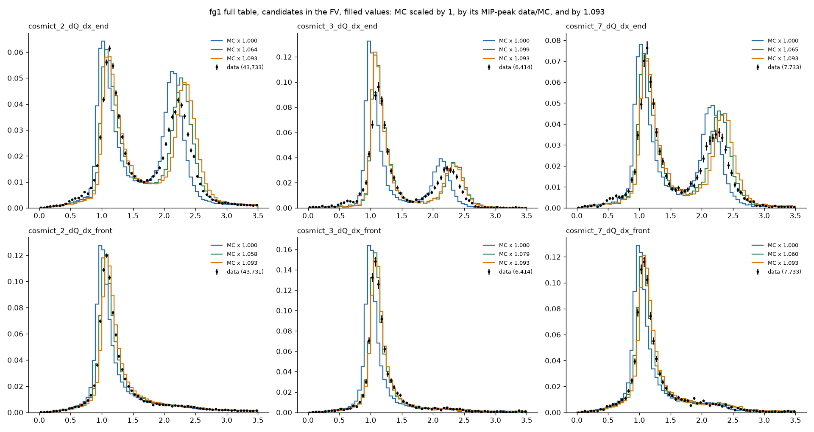
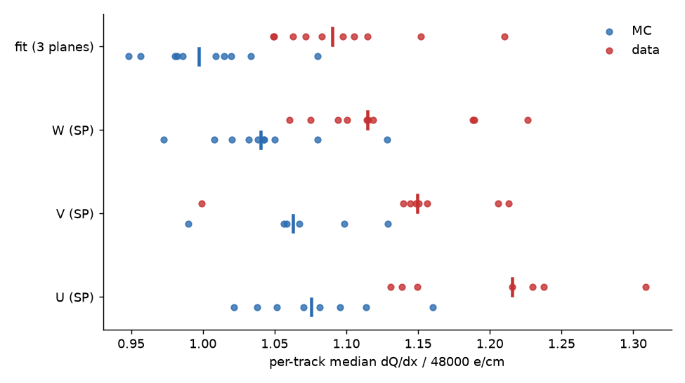
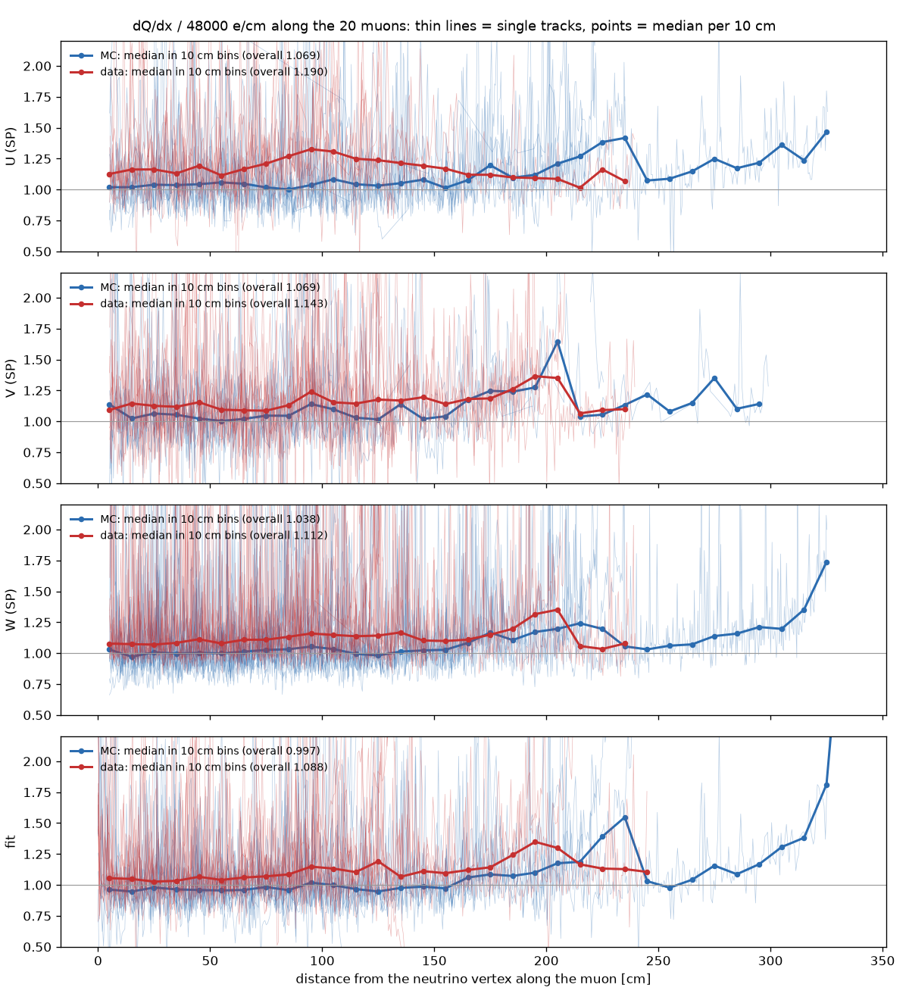
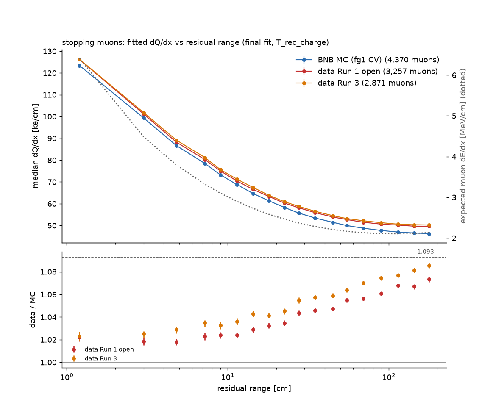
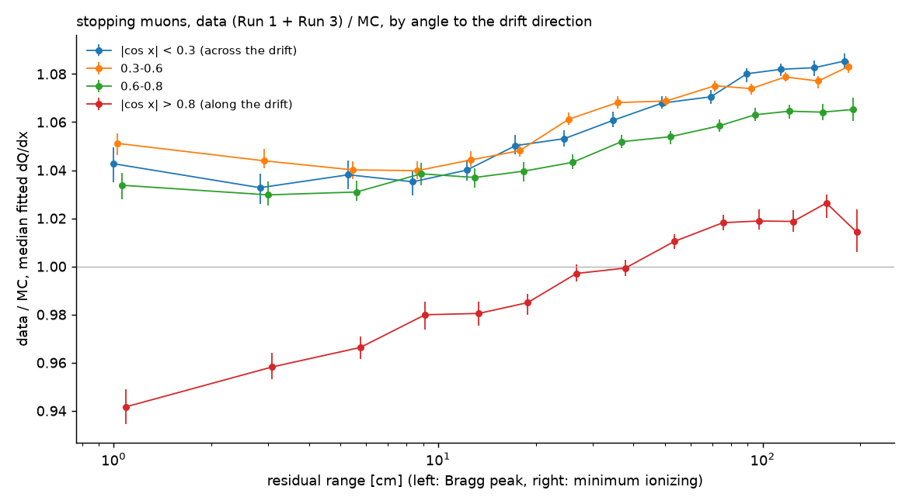
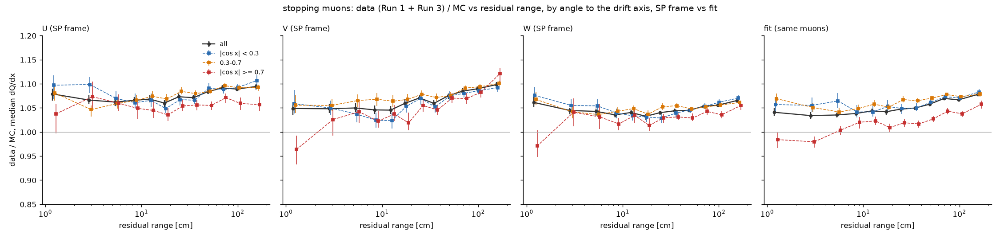
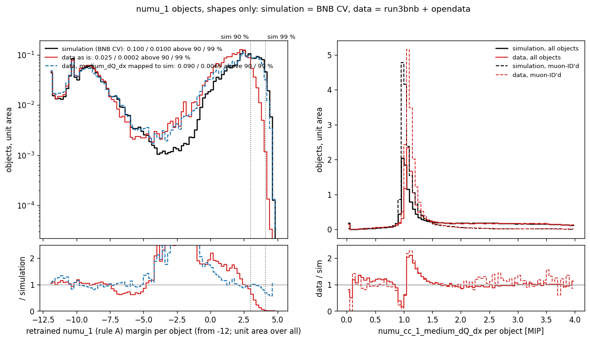
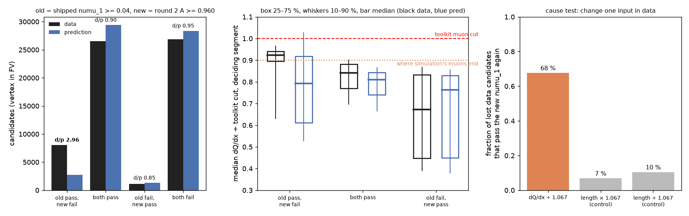

# dQ/dx in data and simulation: what differs, where it starts, and what it does to the νμ BDT

Study on the gpvm, 2026-11-21 to 11-23. Samples are wcl1116 / fg1 BNB simulation (CV) and beam-on data (Run 1 open
data + Run 3 BNB). Reconstruction is the fg1 Wire-Cell chain (toolkit `4b6853d4`). Scripts and full tables live in the
retraining communication repository; ask if you need them.

## Summary

- **Size.** Data has **6–9 % more charge per cm** than simulation along muons that are minimum ionizing.
- **Origin.** The difference is **already in the signal-processing output** that imaging reads. The track fit adds at
  most about 1.5 %.
- **Not a single scale factor.** On stopping muons, data/simulation is about **1.08 where the muon is minimum ionizing
  and 1.02–1.04 at the Bragg peak**. It is also lower for tracks running along the drift direction.
- **Explanation unknown.** Neither a gain change nor a different recombination strength alone describes this. The
  flat part (about 6–8 %) looks like a gain or normalization difference; the part that depends on charge density could
  be recombination.
- **Effect on the BDT.** The level-2 νμ model reacts only mildly (1–2 %) to the offset in its `cosmict_2/3/7` dQ/dx
  inputs.
  - A **retrained level-1 `numu_1` reacts strongly**: it learned its muon boundary at the edge of simulation's narrow
    MIP peak, and data's peak sits across that edge.
  - The shipped `numu_1` (trained on MicroBooNE) is insensitive to dQ/dx.
- **For retraining:** either correct the simulation's charge inputs to data (quantile maps per input and per particle
  type), or keep dQ/dx out of the level-1 muon model.

## 1. The starting point: the BDT dQ/dx inputs

`NeutrinoTaggerCosmic` takes the median fitted dQ/dx over the first (front) and last (end) ~10 fitted points of the main
muon and divides by 48000 e/cm. Those values become `cosmict_N_dQ_dx_front/end`, and in the wcl1116 input comparison
`cosmict_2_dQ_dx_end` was the worst-modelled of the 74 inputs.

*Six cosmict dQ/dx inputs, candidates in the FV, filled values. Blue: simulation as is. Green: simulation scaled by that
input's MIP-peak data/simulation ratio. Orange: simulation × 1.093. Black: data.*

- **Why "end" has two peaks.** "End" is the last few centimetres of the muon. The peak near 1 is muons whose end is
  still minimum ionizing: they exit, or are cut early. The peak near 2.2 is muons that stop inside the detector, where
  the end sits on the Bragg peak. "Front" is minimum ionizing almost always.
- **One scale fits only one peak.** The MIP peaks want 1.06–1.10, the stopping peak only 1.01–1.04. That is why a
  single scale leaves a large residual on the `_end` inputs.

| input | best single scale | MIP-peak data/sim | stopping-peak data/sim |
|---|---:|---:|---:|
| cosmict_2_dQ_dx_end | 1.05 | 1.064 | 1.033 |
| cosmict_2_dQ_dx_front | 1.06 | 1.058 | 1.020 |
| cosmict_3_dQ_dx_end | 1.06 | 1.099 | 1.041 |
| cosmict_3_dQ_dx_front | 1.08 | 1.079 | 1.023 |
| cosmict_7_dQ_dx_end | 1.05 | 1.065 | 1.032 |
| cosmict_7_dQ_dx_front | 1.06 | 1.060 | 1.009 |

## 2. Where dQ/dx is set, and where the difference begins

- **dQ/dx is set** in `TrackFitting::dQ_dx_multi_fit`, which solves for each fitted point's charge and length
  (`clus/src/TrackFitting.cxx`). No gain, lifetime or per-plane correction is applied anywhere in the Wire-Cell chain.
- **Twenty events dumped at two stages.** We reran 10 simulated νμ CC events and 10 data events (νμ candidates with a
  muon > 100 cm) through our own install of the chain, one by one, saving:
  - the signal-processing frame, exactly as imaging reads it;
  - every fitted point right after the dQ/dx fit.
  
  All 20 reruns reproduce the production values exactly (vertex, `numu_score`, every dQ/dx input).
- **On the SP frame, per plane.** We walked along each muon wire by wire, using the fit's own projection onto each
  plane. On each wire, dQ/dx = (SP charge in a window around the track) / (3D length per wire). Bad channels, the first
  and last 5 cm, and wires crossed twice are skipped. Each track gives one median.

| plane | simulation | data | data / simulation |
|---|---:|---:|---:|
| U (SP) | 1.076 | 1.216 | 1.13 (68 %: 1.06–1.16) |
| V (SP) | 1.063 | 1.150 | 1.08 (1.06–1.09) |
| **W (SP)** | 1.040 | 1.115 | **1.07** (1.06–1.10) |
| fit (3 planes) | 0.997 | 1.090 | 1.09 (1.07–1.12) |

*Per-track median dQ/dx / 48000 e/cm. Every data track is above the simulation median.*

- **The difference already exists in signal processing, on all three planes.** Fit/SP per track is 0.978 in data and
  0.964 in simulation, so the fit adds at most about 1.5 %.
- **The projection is right.** The charge centre sits at a constant +1.5 ticks from the predicted position in both
  samples, with 97–99 % of the track's charge inside the windows.
- **Side note on data 3D points.** Written-out data 3D points are shifted by ±0.67 cm in z per TPC (2.23 W wires). This
  is the data-only cathode-misalignment offset `pos_offset_on` in `cfg/pgrapher/experiment/sbnd/clus.jsonnet`. The fit
  undoes it before comparing with the wires, so dQ/dx is not affected. Anyone who projects data 3D points onto wires
  by geometry must undo it too.

*dQ/dx along the muons from the vertex. Thin lines: single tracks. Points: median per 10 cm. Data is above simulation
along the whole track on every plane.*

## 3. Scaling the simulated charge after the fit

A debug-only knob multiplied every fitted charge by 1.093 right after the dQ/dx fit, and the later reconstruction steps
were rerun on 100 simulated events.

- **MIP peaks:** the `_end` inputs move onto data; `cosmict_2_dQ_dx_front` overshoots.
- **Side effect:** the scaled charge **removes the `cosmict_2` muon in 6 of 99 candidates**. The tagger's hand-made
  rules (for example the Bragg test `dQ_dx_end > 1.4 × MIP`) and the particle ID use absolute charge, so the charge
  scale also changes which topology is found, not only the input values.

A simple global rescaling is therefore not a clean fix.

## 4. Stopping muons: the ratio depends on charge density and angle

- **Sample:** muon-ID'd tracks with the reconstructed stopping end at least 15 cm inside the active volume, at least
  10 cm from the cathode, and at least 30 cm long.
  - Fitted points come from the merged CAFs: 4,370 simulated and 6,128 data muons.
  - Fitted charge is stored as `q = 0.1·dQ − 1000`; invert it before taking ratios.

*Top: median fitted dQ/dx against residual range. Dotted line: expected muon dE/dx (Bethe–Bloch with the density effect,
right axis). Bottom: data / simulation, rising from about 1.02 at the Bragg peak to 1.07–1.09 where the muon is minimum
ionizing.*

*Data / simulation in bins of the angle to the drift direction (θx).*

| \|cos θx\| | rr 0–2 cm | 7–10 | 30–40 | 100–130 | 160–200 |
|---|---:|---:|---:|---:|---:|
| < 0.3 (across the drift) | 1.043 | 1.035 | 1.061 | 1.082 | 1.085 |
| 0.3–0.6 | 1.051 | 1.040 | 1.068 | 1.079 | 1.083 |
| 0.6–0.8 | 1.034 | 1.039 | 1.052 | 1.065 | 1.065 |
| > 0.8 (along the drift) | 0.942 | 0.980 | 0.999 | 1.019 | 1.014 |

- **Charge density:** about +4 % from the Bragg peak to the MIP, at every angle.
- **Angle:** about 6 % lower along the drift, at every residual range (in the fit).
- **Not lifetime:** flat in drift distance (1.06–1.07). Run 3 is about 1 % above Run 1.
- **Fits fail:**
  - a pure gain gives χ²/ndf 1417/17;
  - a gain plus a different Modified-Box β (0.280 instead of 0.212) gives 385/16.

### The same muons on the signal-processing frame

Next we checked whether this pattern already exists before the fit. We dumped the SP frame of 846 simulated and 945
data stopping muons and repeated the wire-by-wire measurement per plane.

Data / simulation of the medians: near the stop (residual range 2–20 cm), at the MIP (80–200 cm), and their ratio. Numbers in parentheses are the 68 % bootstrap error over muons.

| source | 2–20 cm | MIP 80–200 cm | MIP / 2–20 cm, all angles | same, across drift (\|cos θx\| < 0.4) | same, along drift (\|cos θx\| ≥ 0.7) |
|---|---:|---:|---:|---:|---:|
| U (SP) | 1.064 | 1.092 | 1.026 (9) | 1.036 (14) | 0.994 (21) |
| V (SP) | 1.054 | 1.094 | 1.038 (10) | 1.041 (14) | 1.069 (18) |
| W (SP) | 1.041 | 1.061 | 1.019 (8) | 1.030 (10) | 1.006 (17) |
| fit | 1.048 | 1.072 | 1.023 (8) | 1.027 (11) | 1.021 (15) |

- **The charge-density dependence is already in SP**, on all three planes: data/simulation is 2–4 % higher at the MIP
  than near the stop.
- **The angle effect is smaller on SP than in the fit.** Near the stop it disappears on U and W, but not in the fit. So
  part of the angle dependence comes from the fit, or from how the fit combines the planes.
- **More along-drift tracks near the stop in data** (W: 14 % in data vs 11 % in simulation). That mix pulls the
  all-angle ratio there.

### What it means for the detector model

- **The simulation uses EMB.** sbndcode v10_14_02_03 uses angle-dependent ellipsoid modified-box recombination
  (`UseEllipsModBoxRecomb: true`), not Birks.
- **Data/simulation splits into two parts:**
  - a **flat offset of about 6–8 %** at the MIP, larger than plausible recombination tuning. It looks like gain,
    charge normalization or signal-processing normalization;
  - a **few-percent dependence on charge density**: relatively less charge in data at high dE/dx, i.e. stronger
    saturation. This part is recombination-like.
- **Not yet excluded,** all of which also depend on charge density:
  - end-point resolution and Michel overlap near the stop;
  - signal-processing losses for dense charge;
  - muon ID using absolute dQ/dx templates;
  - space charge near the walls.
- **Next steps that would settle it:**
  - an MC closure test (SP charge vs the true electrons per wire from SimChannels);
  - a data fit of the scale plus the recombination parameters on stopping muons and protons.

## 5. What it does to the νμ BDT

**How the inputs enter.**
- `cosmict_2/3/7` are single values per candidate. Every field (13 / 10 / 13 of them, including the six dQ/dx) goes
  **directly into the level-2 νμ model**.
- `numu_cc_1` (all segments at the vertex) is a list, condensed by the level-1 `numu_1` model (maximum over segments).
- One of numu_1's seven inputs is `numu_cc_1_medium_dQ_dx`, the median dQ/dx of the whole segment ÷ 48000. It is not
  a level-2 input, so it does not appear in the 74-input comparison.

**What was seen.**
- Retraining only the level-2 model (round 1) keeps data/prediction at the shipped level: 1.048 vs 1.059 at 95 %
  purity.
- Also retraining the level-1 models (round 2, rule A) drops it to 0.982.

*Left: the retrained `numu_1` output per segment for simulation, data, and data with only `medium_dQ_dx` rank-mapped to
simulation. Lines: simulation's 90 / 99 % quantiles. Data is short at the top (0.025 / 0.0002 above the lines instead of
0.100 / 0.010), and mapping that one input restores it (0.090 / 0.0065). Right: `medium_dQ_dx` per segment. The data muon
peak sits about 6.7 % higher (muon-ID'd medians 1.041 in simulation, 1.111 in data).*

**Which candidates are lost.** Compare the shipped `numu_1` (score ≥ 0.04) with the retrained one (≥ 0.960):

| group | data | prediction | data/pred |
|---|---:|---:|---:|
| shipped passes, retrained fails | 8050 | 2723 | **2.96** |
| both pass | 26537 | 29387 | 0.90 |
| shipped fails, retrained passes | 1108 | 1304 | 0.85 |

- **Who they are:** long muons (median 148 cm). The shipped flag_1 fires on 82 % of them.
  - 68 % of them have `medium_dQ_dx / cut` in 0.9–1.0: below the toolkit's muon cut (1.0) but above about 0.9.
  - About 0.9 is where simulation's muons end: 90 % of simulated passing muons are below 0.87.
  - The retrained model learned its boundary there, not at the toolkit cut.
- **Cause test:** dividing data `medium_dQ_dx` by 1.067 brings back 68 % of them. Scaling the track length by the same
  amount (control) brings back 7–10 %.
  - With the dQ/dx change, data/pred for the retrained numu_1 becomes 1.08, the same as the shipped model.
- **Correcting the simulation instead,** the retrained chain reaches 1.032. That uses a rank map per reconstructed
  particle type (muons +6.7 %, pions +6 %, protons +1 %) plus a per-input scale on the cosmict dQ/dx.
  - Round 1 reaches 1.069 with the same cosmict correction.
  - About 3.5 % of the difference between the two remains unexplained by the dQ/dx inputs.
- **Level-2 inputs alone:** correcting the six cosmict dQ/dx inputs moves the shipped, round 1 and round 2 selections
  by only 0.7–1.9 %.
  - Round 1's own selection has 34 % more data than predicted where `cosmict_2_dQ_dx_end` is 1.3–1.9. That is the
    valley between the two peaks, filled from below by the shifted MIP peak.
  - So a cut in that valley is not safe in data.

## 6. Recommendations

1. **For BDT retraining now:**
   - train with the simulation's charge inputs mapped to data (quantile maps per cosmict input, and per particle type
     for `numu_cc_1_medium_dQ_dx`);
   - or keep dQ/dx out of the level-1 muon model;
   - or keep the shipped `numu_1`.
   
   A single global scale is not enough: it fits the MIP peak but not the stopping peak, and it changes topology finding.
2. **For the detector model (calibration):**
   - calibrate the absolute charge scale in data on minimum-ionizing muons;
   - fit the recombination parameters against dE/dx and angle on stopping muons and protons;
   - run an MC closure test of signal processing against SimChannels, to separate detector physics from SP.
3. **Anyone projecting data 3D points onto wires** must undo the data-only `pos_offset_on` shift.
